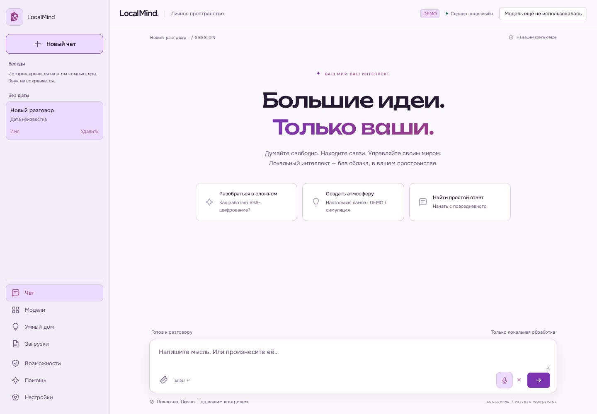

# LocalMind

LocalMind is a Russian-language desktop assistant. It answers through a local model and carries out permitted actions with apps and files. You can edit the speech transcript before sending it.

[Русский](README.md) · [Downloads](https://github.com/wiseakk/LocalMind/releases) · [Demo checklist](docs/QUICK_DEMO.md)

| Try | What to expect |
| --- | --- |
| **Ask out loud** | Whisper transcribes the recording. Check the draft before sending and listen to Silero if voice resources are configured. [Voice settings](docs/screenshots/voice.png) |
| **Ask a local model** | Ollama generates an answer on your computer. Gemma 4 12B was used in the recorded demo. [Chat](docs/screenshots/chat.png) |
| **Open an app** | Grant launch permission to a discovered app, then ask LocalMind to open it. System adapter availability depends on your desktop. [App catalogue](docs/screenshots/apps.png) |
| **Read a file** | Grant read access to a demo folder, request a file, revoke the rule and repeat to see the refusal. [Permissions](docs/screenshots/permissions.png) |

## Getting started

- **CachyOS / Arch x86_64 (Linux Alpha).** The desktop was tested on CachyOS with Hyprland and Wayland. Download the [rc3-5 package and SHA-256](https://github.com/wiseakk/LocalMind/releases/tag/v1.0.0-rc3.5-arch). Install with `pacman -U`, then run `localmind`. See the [Linux setup guide in Russian](docs/LINUX_INSTALL.md) for source and voice setup.
- **Windows 10/11 (RC3).** Start from the [Windows source branch](https://github.com/wiseakk/LocalMind/tree/release/1.0.0-rc3) using the [PowerShell setup guide in Russian](docs/WINDOWS_INSTALL.md). The current installer, microphone and GPU still need a hardware acceptance run.

Check Releases for source archives and available packages. Initial dependency and model setup can require an internet connection. After setup, compatible chat and voice workflows can run over loopback.

## Privacy and architecture

The FastAPI server binds to loopback, and SQLite keeps conversations in the local profile. Recording starts on request. The system adapter checks permissions and reports the observed outcome. Qt WebEngine hosts the UI, with Ollama, Whisper and Silero handling generation, transcription and speech.

[Architecture](docs/ARCHITECTURE.md) · [Test evidence](docs/DEVELOPMENT_EVIDENCE.md) · [Security](SECURITY.md)

## Roadmap and contributions

The next validation targets are Windows hardware, measured Russian speech recognition quality and additional Wayland compositors.

[Contributing](CONTRIBUTING.md) · [MIT](LICENSE) · [Third-party and model licences](docs/LICENSING.md)
