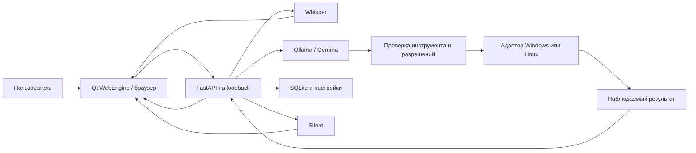

# LocalMind

**Локальный голосовой ассистент для компьютера.** LocalMind понимает текст и русскую речь, отвечает через локальную модель и выполняет разрешённые действия с приложениями и файлами. После загрузки зависимостей и моделей основной сценарий работает через loopback.

| Платформа | Статус |
| --- | --- |
| CachyOS / Arch x86_64 | Linux Alpha, пакет `1.0.0rc3-4`. Проверки проводились на CachyOS с Hyprland/Wayland. |
| Windows 10/11 | RC3. Сохранены исходники, история и рецепты сборки. Микрофон и GPU для этой публикации не проверены. |

[Установка Linux](docs/LINUX_INSTALL.md) · [Установка Windows](#windows-rc3) · [Материалы защиты](docs/PRESENTATION.md) · [Релиз исходников](https://github.com/wiseakk/LocalMind/releases/tag/v1.0.0-rc3.4-source.1)

## Интерфейс


[Диалог с Gemma](docs/screenshots/chat.png) · [Голосовые настройки](docs/screenshots/voice.png) · [Приложения](docs/screenshots/apps.png) · [Разрешения](docs/screenshots/permissions.png) · [Модели](docs/screenshots/models.png)

## Что умеет LocalMind

- **Диалог и голос.** Ollama с локальной Gemma, распознавание через faster-whisper, редактируемая расшифровка и озвучка через Silero.
- **Работа с компьютером.** Каталог установленных приложений, запуск по разрешению, проверка результата, фокусировка поддерживаемых окон и чтение разрешённых файлов.
- **Локальный профиль.** История бесед в SQLite, настройки, модели и правила доступа хранятся на компьютере. Постоянной записи микрофона нет.
- **Офлайн-сценарий.** Зависимости и веса нужно подготовить заранее. Умный дом в режиме DEMO моделирует действие локально.

## Архитектура



[Потоки данных и границы доверия](docs/ARCHITECTURE.md)

## Запуск

### CachyOS / Arch

Из исходников установите зависимости по [инструкции Linux](docs/LINUX_INSTALL.md). После настройки Ollama и голосовых ресурсов используйте одну команду из корня:

```sh
QT_QPA_PLATFORM=wayland .venv/bin/python -m localmind.desktop
```

Для установленного Arch-пакета команда запуска — `localmind`. Для веб-режима используйте `.venv/bin/python start.py` и откройте `http://127.0.0.1:8765`. [Диагностика Linux](docs/LINUX_INSTALL.md#диагностика)

### Windows RC3

В PowerShell из Windows-ветки выполните подготовку с сетью:

```powershell
.\setup_windows.ps1 -Voice
```

Для текстового режима используйте скрипт подготовки без `-Voice`. После установки Ollama и загрузки подходящей модели запустите `.\start_windows.ps1` и откройте `http://127.0.0.1:8765`. Отдельный [рецепт Desktop-сборки](installer/LocalMind.iss) предназначен для упаковки Windows RC3. [Ручная приёмка Windows](MANUAL_QA.md)

### Требования и измерения

- Для веб-интерфейса нужны Python и зависимости из `requirements.txt`. Для Linux Desktop проверена среда Python 3.14.10 x86_64 с Qt WebEngine. Аппаратный минимум для полной конфигурации не измерялся.
- Для профиля Gemma 4 12B Q4_K_M ориентир — RTX 4070 с 12 ГБ VRAM и 32 ГБ RAM. Проверенный тег занимал около 8 ГБ на диске. Whisper Small можно запускать на CPU.
- В исторической Linux-приёмке Ollama показал полное размещение Gemma на GPU при контексте 4096. Whisper Medium при нехватке VRAM обработал одну фразу на CPU за 1646 мс inference. Это отдельный замер, без обобщения на другие фразы или ПК. [Условия замеров](docs/LINUX_ALPHA_ACCEPTANCE.md)
- Для rc3-4 зафиксированы 20 из 20 повторных запусков извлечённого Qt-пакета под Wayland. [Журналы и воспроизведение](docs/DEVELOPMENT_EVIDENCE.md)

## Безопасность

API слушает `127.0.0.1`. Модель может предложить действие из объявленного набора. Приложение проверяет цель, разрешение, необходимость подтверждения и фактический результат. Сетевое сопряжение в roadmap. [Модель доступа](docs/ACCESS_POLICY.md) · [Сообщить об уязвимости](SECURITY.md)

## Разработка и тесты

```sh
python -m pip install -r requirements-dev.txt
python -m pytest -q
npm ci
npm run check:ui
npm run check:assets
npm run test:dom
```

Для Chromium подготовьте браузер через `npx playwright install chromium`, запустите LocalMind с тестовым профилем и выполните `npm run test:ui`. Часть сценариев браузера использует фикстуры API. Отдельные [локальные проверки](docs/LINUX_MANUAL_QA.md) требуют Ollama, моделей, графического сеанса или аудиоустройств.

## Дальнейшая работа

Повторная аппаратная приёмка Windows, измерения WER/CER на согласованном наборе записей, расширение покрытия оконных менеджеров и защищённое сопряжение домашних клиентов.

## Авторы и компоненты

LocalMind разработал wiseakk с помощью Codex. Собственный код доступен по [MIT](LICENSE). Второй участник команды выступает на школьной защите. Встроенный UI использует Marked, KaTeX, DOMPurify и шрифты Onest и Unbounded. FastAPI, Qt/PySide6, Ollama, faster-whisper и Silero используются как отдельные компоненты. Веса моделей имеют собственные условия и загружаются отдельно. [Лицензии и статус распространения](docs/LICENSING.md)
