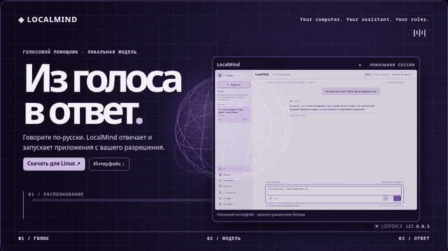
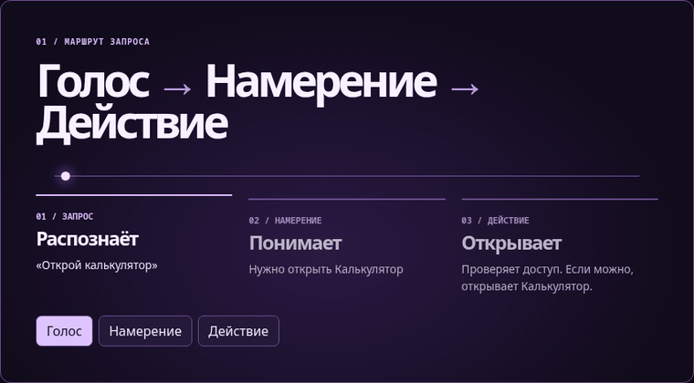
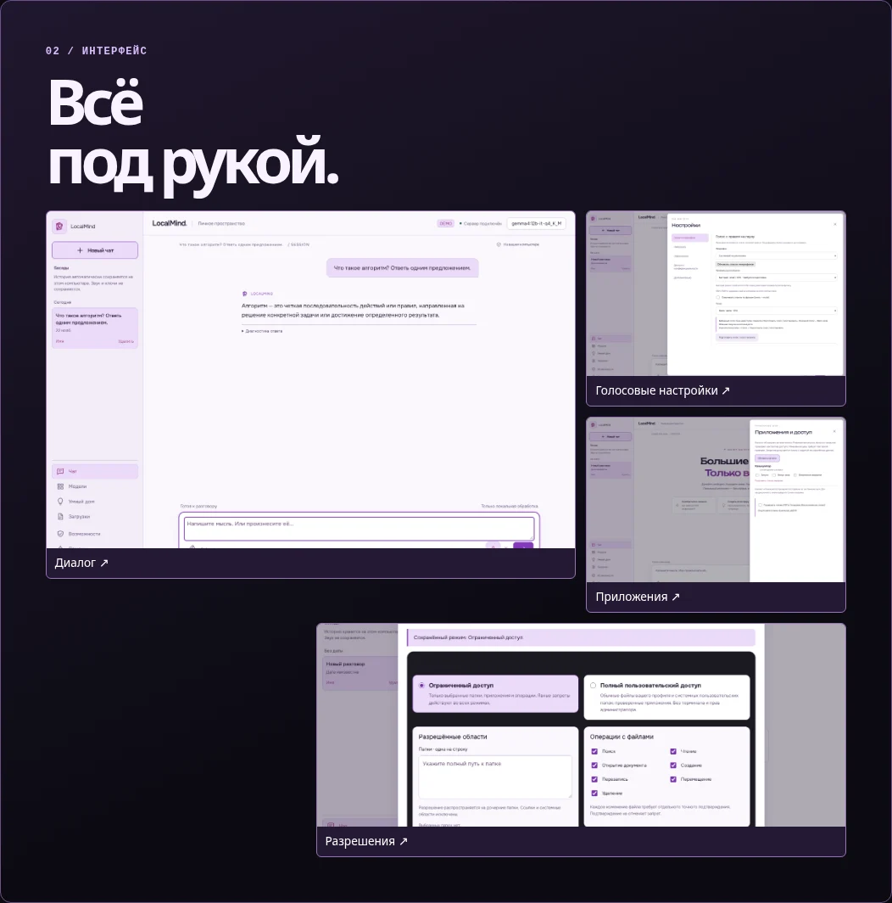
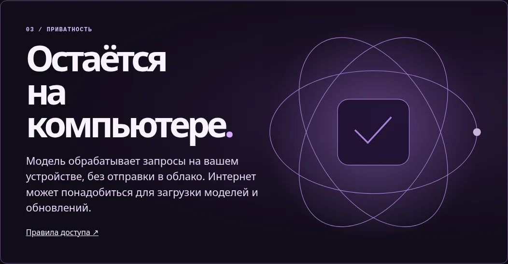
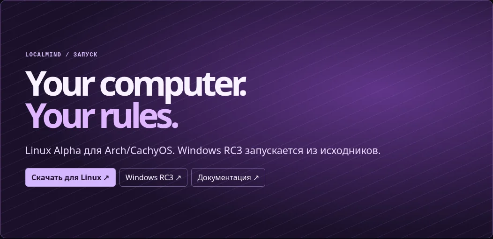

<picture>
  <source media="(max-width: 620px)" srcset="docs/brand/showcase/localmind-hero-390.webp">
  <source media="(prefers-reduced-motion: reduce)" srcset="docs/brand/showcase/localmind-hero-1100.webp">
  
</picture>

[**Скачать для Linux ↗**](https://github.com/wiseakk/LocalMind/releases) · [Windows RC3 ↗](https://github.com/wiseakk/LocalMind/blob/main/docs/WINDOWS_INSTALL.md) · [Интерфейс](#всё-под-рукой)

*Your computer. Your assistant. Your rules.*

## Голос → Намерение → Действие

<picture>
  <source media="(max-width: 620px)" srcset="docs/brand/showcase/localmind-flow-390.webp">
  <source media="(prefers-reduced-motion: reduce)" srcset="docs/brand/showcase/localmind-flow-1100.webp">
  
</picture>

Вы говорите «Открой калькулятор». LocalMind распознаёт речь, определяет, какое приложение нужно открыть, и проверяет разрешение. Если запуск разрешён, открывается Калькулятор.

## Всё под рукой

<picture>
  <source media="(max-width: 620px)" srcset="docs/brand/showcase/localmind-interface-390.webp">
  
</picture>

[Диалог](https://github.com/wiseakk/LocalMind/blob/main/docs/screenshots/chat.png) · [Голос](https://github.com/wiseakk/LocalMind/blob/main/docs/screenshots/voice.png) · [Приложения](https://github.com/wiseakk/LocalMind/blob/main/docs/screenshots/apps.png) · [Разрешения](https://github.com/wiseakk/LocalMind/blob/main/docs/screenshots/permissions.png)

## Остаётся на компьютере

<picture>
  <source media="(max-width: 620px)" srcset="docs/brand/showcase/localmind-privacy-390.webp">
  
</picture>

Модель обрабатывает запросы на устройстве. Интернет может понадобиться для загрузки моделей и обновлений.

[Правила доступа ↗](https://github.com/wiseakk/LocalMind/blob/main/docs/ACCESS_POLICY.md)

## Скачать

<picture>
  <source media="(max-width: 620px)" srcset="docs/brand/showcase/localmind-download-390.webp">
  
</picture>

[Linux Alpha · Arch/CachyOS ↗](https://github.com/wiseakk/LocalMind/releases) · [Windows RC3 · из исходников ↗](https://github.com/wiseakk/LocalMind/blob/main/docs/WINDOWS_INSTALL.md) · [Документация ↗](https://github.com/wiseakk/LocalMind/tree/main/docs) · [English](https://github.com/wiseakk/LocalMind/blob/main/README.en.md)
