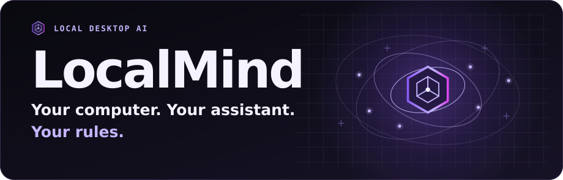
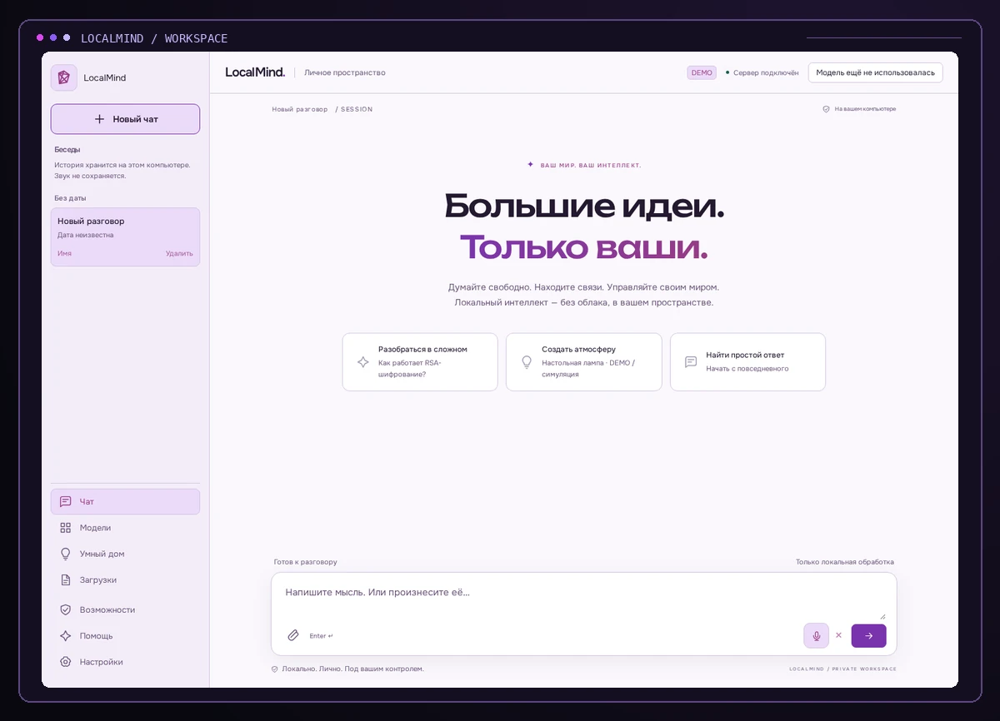
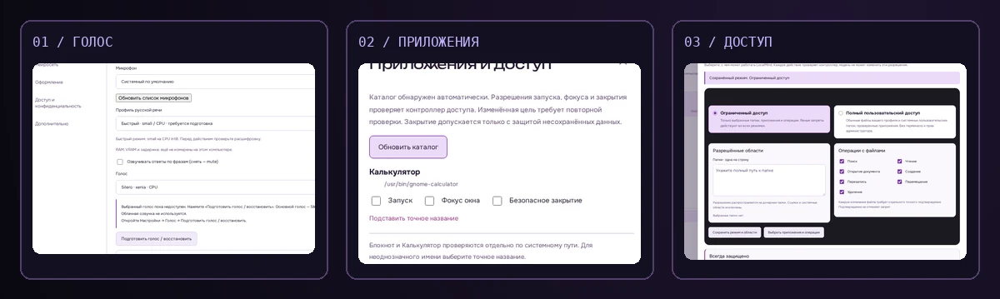
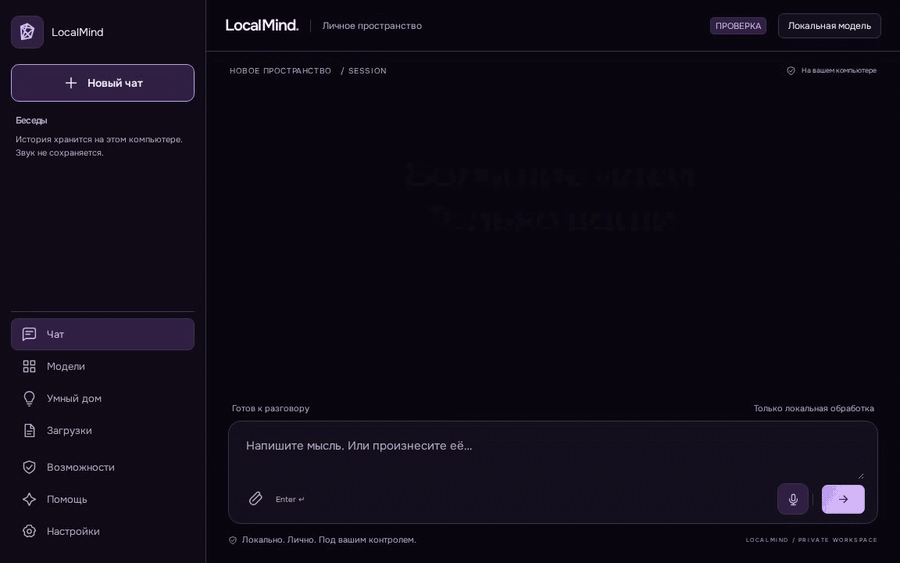
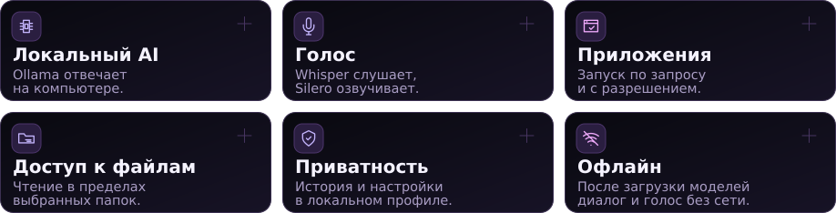

<picture>
  <source media="(max-width: 600px)" srcset="docs/brand/hero-mobile.svg">
  
</picture>

**Голосовой помощник для вашего компьютера.** Понимает русский, отвечает через локальную модель и работает с приложениями и файлами в рамках выданных разрешений.

[**Скачать**](#скачать) &nbsp;·&nbsp; [Интерфейс](#интерфейс) &nbsp;·&nbsp; [Документация](#документация) &nbsp;·&nbsp; [English](README.en.md)

## Интерфейс

<picture>
  <source media="(max-width: 600px)" srcset="docs/brand/interface-mobile.webp">
  
</picture>

[Голос](docs/screenshots/voice.png) &nbsp;·&nbsp; [Приложения](docs/screenshots/apps.png) &nbsp;·&nbsp; [Разрешения](docs/screenshots/permissions.png) &nbsp;·&nbsp; [Диалог](docs/screenshots/chat.png)

<strong>Посмотреть в движении</strong> · короткое превью rc3-6

 

Запись тестового кандидата rc3-6. Доступный пакет Linux указан в разделе «Скачать».

## Возможности

<picture>
  <source media="(max-width: 600px)" srcset="docs/brand/features-mobile.svg">
  
</picture>

## Как это ощущается

> **Вы** &ensp; «Открой калькулятор». 
> **LocalMind** &ensp; Открывает установленный Калькулятор после выдачи разрешения.

Можно также спросить «Что такое алгоритм?» голосом, исправить расшифровку перед отправкой и прослушать ответ после настройки Silero. [Попробовать сценарии](docs/QUICK_DEMO.md)

## Скачать

**Linux · Alpha** — Arch и CachyOS x86_64. [Пакет rc3-5 и SHA-256](https://github.com/wiseakk/LocalMind/releases/tag/v1.0.0-rc3.5-arch) · [Установка](docs/LINUX_INSTALL.md)

**Windows · RC3** — запуск из исходников через PowerShell. [Инструкция для Windows 10/11](docs/WINDOWS_INSTALL.md)

## Документация

[Архитектура](docs/ARCHITECTURE.md) &nbsp;·&nbsp; [Данные и разрешения](docs/ACCESS_POLICY.md) &nbsp;·&nbsp; [Ограничения](docs/KNOWN_LIMITATIONS.md) &nbsp;·&nbsp; [Проверки](docs/DEVELOPMENT_EVIDENCE.md)

---

[**wiseakk**](https://github.com/wiseakk) &nbsp;·&nbsp; [Внести вклад](CONTRIBUTING.md) &nbsp;·&nbsp; [Безопасность](SECURITY.md) &nbsp;·&nbsp; [MIT](LICENSE) &nbsp;·&nbsp; [Лицензии моделей](docs/LICENSING.md)

